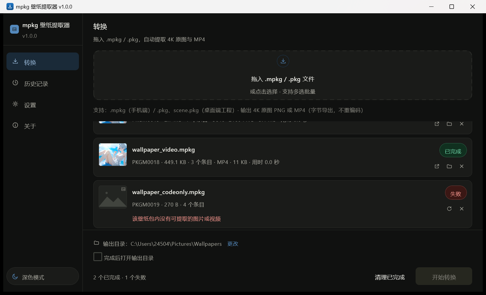
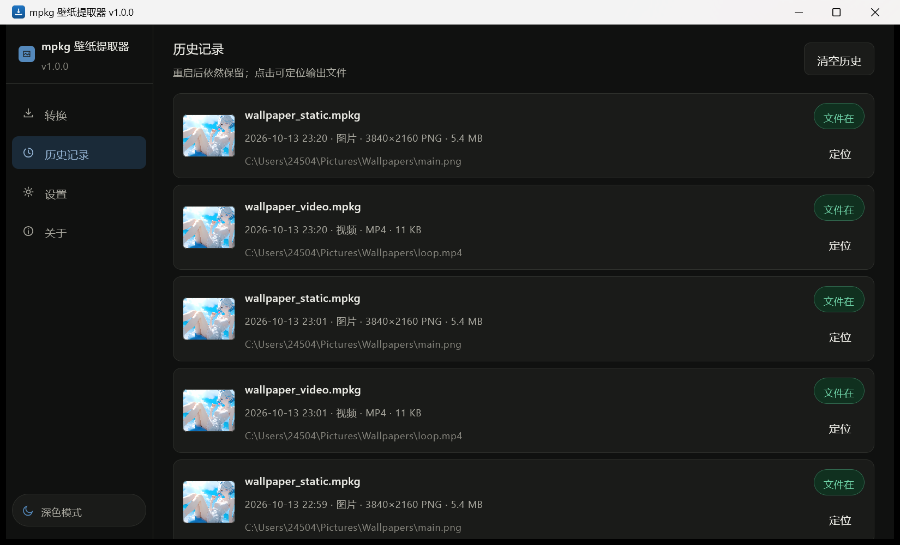
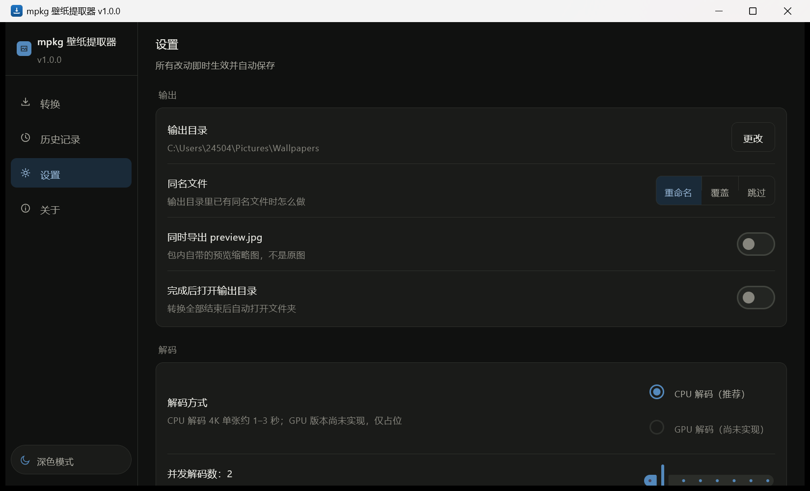
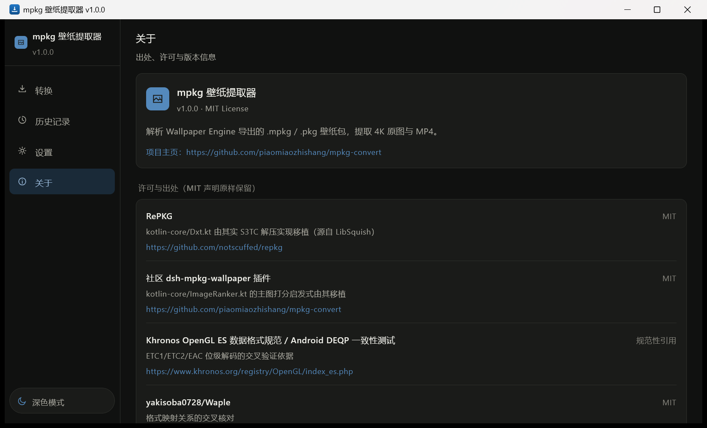

# mpkg 壁纸提取器（桌面版）

解析 Wallpaper Engine 导出的 `.mpkg`（手机端）/ `.pkg`、`scene.pkg`（桌面端工程）壁纸包，
提取 **4K 原图（PNG 无损）**、**MP4 视频（字节导出，不重编码）** 与包内预览图。

- 目标平台：Windows / macOS / Linux
- 技术栈：Kotlin 2.1 + Compose Multiplatform Desktop 1.7（Material3）+ JDK 17
- 本项目主页：<https://github.com/piaomiaozhishang/mpkg-convert-desktop>
- 检查更新地址（Gitee，国内可直接访问）：<https://gitee.com/piaomiaozhishang/mpkg-convert-desktop/raw/master/update.json>
- 上游 Android 版：<https://github.com/piaomiaozhishang/mpkg-convert>
- 交接包原始说明：见 [docs/交接包README.md](docs/交接包README.md)

---

## 快速开始

```bash
# 1) 构建（首次会下载 Gradle 发行包与依赖）
./gradlew build                 # Windows: .\gradlew.bat build

# 2) 跑单元测试
./gradlew :core:test :composeApp:test

# 3) 启动图形界面
./gradlew :composeApp:run

# 4) 命令行模式（不开窗口）
./gradlew :composeApp:cli --args="sample/texture.tex out.png --scale 1280x720 --compare sample/expected_1280x720.png"

# 或打成可独立运行的 CLI
./gradlew :composeApp:cliJar
java -jar composeApp/build/libs/mpkg-cli.jar --help
```

环境要求：**JDK 17**（必须含 `jpackage`）；Gradle 由 Wrapper 提供，无需手动安装。
详见 [01-环境搭建指南.md](01-环境搭建指南.md)。

---

## 下载与使用

到 [Releases](https://github.com/piaomiaozhishang/mpkg-convert-desktop/releases) 下载对应平台的压缩包：

| 平台 | 文件 | 使用方式 |
|---|---|---|
| Windows | `mpkg-tool-windows-x64.zip` | 解压后**整个目录**一起拷贝，双击 `mpkg-tool\mpkg-tool.exe` 即可，无需安装 JDK（运行时已内置） |

> app-image 是「绿色目录」：`runtime`、`app` 与 exe 不能拆散，可随意搬位置、发给别人。
> 安装版（MSI）需要 WiX 3.x，本仓库不提供。

---

## 界面

| 转换（空状态） | 转换（完成 / 失败） |
|---|---|
|  |  |

| 历史记录 | 设置 | 关于 |
|---|---|---|
|  |  |  |

界面概念稿见 [桌面版GUI概念稿.svg](桌面版GUI概念稿.svg)。

---

## 用法

1. **拖入** `.mpkg` / `.pkg` 到窗口（或点虚线框选择文件，支持多选批量）；
2. 在底部确认**输出目录**与覆盖策略（可在设置里改）；
3. 点**开始转换**；卡片实时显示「等待中 → 解码中(进度) → 已完成 / 失败」；
4. 完成后双击卡片用系统程序打开，或点文件夹图标在资源管理器里定位。

**快捷键**：`Ctrl+O` 选择文件 · `Ctrl+,` 打开设置 · `Delete` 移除选中卡片 · `Esc` 取消全部进行中的任务。

**输出规则**

| 壁纸类型 | 输出 |
|---|---|
| 静态壁纸（含 ETC2_RGBA8 / DXT / 内嵌 PNG/JPEG/GIF） | 4K 原图 PNG（无损）；内嵌图片原样导出 |
| 视频壁纸（`.mp4` 条目或视频纹理） | MP4 **字节导出**，SHA-256 与包内条目一致 |
| 任意 | 可选同时导出包内 `preview.jpg` 缩略图 |

**命令行**

```
mpkg-cli <输入> [输出] [选项]
  --out-dir <目录>        输出目录（默认当前目录，不存在会自动创建）
  --scale <宽x高|倍率>    额外导出一份缩放图（Pillow 兼容 Lanczos）
  --preview               同时导出预览图
  --compare <期望图.png>  与期望图逐像素比对，输出 PASS / FAIL
  --list                  只列出包内条目
  --hash                  打印输出的 SHA-256（MP4 字节一致性验收用）
  --overwrite <策略>      skip / overwrite / rename（默认 overwrite）
  --debug                 打印调试日志与异常堆栈
```

退出码：`0` 成功 · `1` 处理失败 · `2` 用法错误 · `3` 包内没有可提取内容。

---

## 验收标准

| 项 | 标准 | 现状 |
|---|---|---|
| core 四类测试 | Dxt / Etc2CpuDecoder / MainImage / PkgExtractor 全绿 | 24 项全绿 |
| 端到端 | `sample/texture.tex` 解出的图与 `sample/expected_1280x720.png` 逐像素一致 | 差异像素 0 / 921600 |
| 真实包 | 原图正确、MP4 可播放且字节与包内一致 | SHA-256 完全一致 |
| 负向 | 乱数据 / 截断 / 错误魔数不崩溃 | 10 / 10 报错不崩 |
| 界面 | 双主题、动效开关、历史、设置、错误提示 | 51 项单元测试 + 人工验收 |

一条命令跑完自动部分：

```powershell
powershell -ExecutionPolicy Bypass -File scripts/verify-release.ps1
```

---

## 已知边界（照实说）

- **纯代码 / 网页类壁纸**、未导出 `.mpkg` 的原始场景工程：包内没有现成 MP4 或纹理，提取不了，会明确提示「该壁纸包内没有可提取的图片或视频」。
- **TEXF 动帧容器**（动态序列帧壁纸）暂不支持，遇到时跳过并提示，不会崩。
- **ASTC / BC7（纹理 Format 12）** 可识别但不支持解码，提示「该纹理格式暂不支持解码」。
- **加密或非标准魔数**的包按格式错误处理。
- **GPU 解码尚未实现**，设置页里的开关仅占位。CPU 解码 4K 单张约 1–3 秒；`Etc2CpuDecoder` 使用共享 scratch 数组、**非可重入**，因此 ETC2 解码在壳层被串行化（并发度仍可按设置调整，PNG 编码与 I/O 仍并行）。
- **macOS 文件关联**需要改 `Info.plist`，jpackage 不直接支持，未实现；Windows/Linux 由打包配置注册。
- **macOS 的 dmg、Linux 的 deb/rpm** 需在对应平台执行打包；本仓库在 Windows 上验证了 app-image 产物。

---

## 打包

```bash
./gradlew :composeApp:createDistributable   # 免安装目录（app-image），三平台通用
./gradlew :composeApp:packageMsi            # Windows 安装包（需先安装 WiX Toolset 3.x）
./gradlew :composeApp:packageDeb            # Linux 安装包
./gradlew :composeApp:packageDmg            # macOS 安装包
```

> **Windows + 中文项目路径的坑**：Compose Gradle 插件用 UTF-8 写 jlink 的 `@argfile`，
> 而 jlink 按系统本地编码（简体中文 Windows 是 GBK）读取，中文路径会变成乱码、
> 产物落到一个乱码目录里并报 `directory already exists`。
> 解决办法是让构建走一个纯 ASCII 路径，例如建立目录联接后从联接路径构建
> **（必须用 PowerShell 或 cmd：Git Bash 派生子进程时会把联接解析回真实路径， tricks 失效）**：
>
> ```cmd
> mklink /J D:\mpkg-ascii "D:\pro-workbuddy\mpkg转换windows端"
> cd /d D:\mpkg-ascii && gradlew.bat :composeApp:createDistributable
> ```
>
> 另外，重新打包前确认没有正在运行的 `mpkg-tool.exe`：运行中的程序会占住
> `binaries\main\app` 里的 jar，jpackage 删不掉旧产物会报
> `Unable to delete directory ... New files were found`。

输出目录：`composeApp/build/compose/binaries/`。

---

## 检查更新

- 默认每 **12 小时** 自动检查一次（设置里可关），打开软件稍后也会检查一次；发现新版本弹公告
- 检查地址走 **Gitee**（`update.json` 放在仓库根目录随仓库发布）：很多人连不上 GitHub raw，Gitee 国内可直接访问
- 版本比较为逐段数值比较（`1.0.10 > 1.0.9`）
- 公告提供「下载新版本」/「忽略新版本（再也不提示）」；设置页还可改检查地址、下载地址、重新提示已忽略版本
- 「下载新版本」地址优先级：`update.json` 的 `downloadUrl` → 设置里的下载地址 → 项目主页

### 发布新版本

1. 改 `composeApp/src/main/kotlin/com/mpkg/app/AppInfo.kt` 里的 `VERSION`
2. `./gradlew :composeApp:createDistributable` 打出新包，上传到下载地址（GitHub Releases / 网盘均可）
3. 更新仓库根目录的 `update.json` 并推送到 Gitee：

```json
{
  "version": "1.0.1",
  "downloadUrl": "https://你的下载地址/mpkg-tool-windows-x64.zip",
  "notes": "本次更新说明，展示在公告窗里",
  "force": false
}
```

也支持纯文本格式：第一行写版本号即可（下载地址回到设置里配）。`"force": true` 时公告不可忽略、不可关闭（强制更新）。

---

## 目录结构

```
core/                       纯 JVM 核心（来自交接包，原样复用，包名不动）
  src/main/kotlin/com/doubao/repkg/…
  src/test/{kotlin,resources}/…
composeApp/                 桌面壳（Compose Multiplatform）
  src/main/kotlin/com/mpkg/app/
    ui/theme/               设计令牌与双主题（T3.1）
    ui/components/          拖拽区、任务卡片、导航等复用组件
    ui/screens/             转换 / 历史 / 设置 / 关于
    queue/                  解码编排：队列 / 协程 / 进度 / 取消（T2.4）
    export/                 导出与覆盖策略（T2.5）
    extract/                壳层对 core 的唯一解码入口
    history/ settings/      history.json / settings.json 持久化
    platform/               文件对话框、拖拽、系统集成、路径约定
    tools/                  CLI 与 PNG 比对工具
scripts/                    图标 / 夹具 / 负向样本生成、发布回归脚本
docs/                       交接包文档 + 本项目的界面截图
```

---

## 反馈渠道

- 上游项目 Issue：<https://github.com/piaomiaozhishang/mpkg-convert/issues>
- 反馈时请附上应用内「关于 → 复制诊断信息」的内容（版本、平台、配置目录、输出目录与当前设置），
  以及失败卡片上的提示文案。

## 许可

MIT，见 [LICENSE](LICENSE)。引用代码（RePKG、ImageRanker、Pillow 复刻）的出处与许可声明
必须原样保留，详见 LICENSE 与「关于」页。
