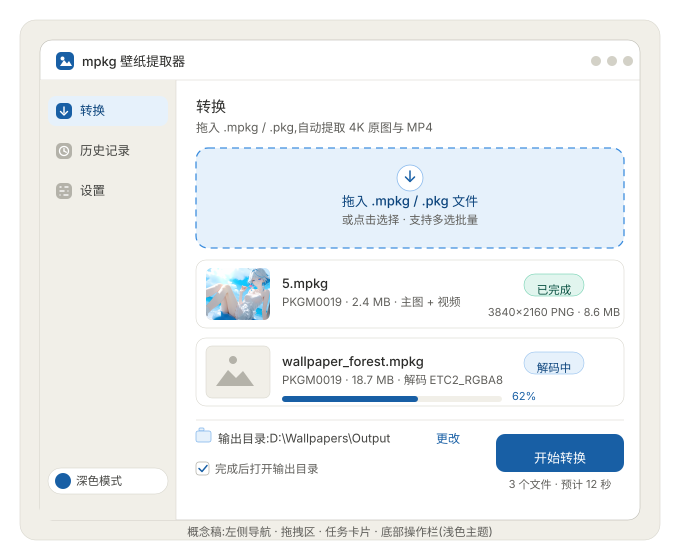

# 桌面版项目统筹与 AI Agent 工作指引(递交报告)

| 项 | 内容 |
|---|---|
| 项目 | Wallpaper Engine mpkg/pkg 壁纸提取器 · 桌面版 |
| 版本 / 日期 | v1.0 / 2026-10-13 |
| 状态 | 待评审 |
| 输入依赖 | 桌面版交接包(README.md、技术总结与移植指南.md、桌面版交接包.zip) |
| 目标平台 | Windows / macOS / Linux |

---

## 0. 摘要

- **一句话**:把已上线的 Android 壁纸提取器的核心技术,做成三平台桌面版。解析/解码核心零移植,全部新增工作量在桌面壳、GUI 打磨与打包。
- **技术选型**:**Compose Multiplatform Desktop(Kotlin)**。在跨平台框架中,它是唯一能让 `kotlin-core` 原样进场的选项——本项目最大的风险(ETC2/DXT/LZ4 位级解码,验收要求逐像素一致)因此被清零;UI 侧还能继承 Android 版的 Compose Material3 代码。
- **工作量判断**(1 名工程师 + AI agent):核心接住约 0.5 天 → 可用版 3–5 天 → 精美版 3–5 天 → 可发布 2–3 天,合计约 2 周,深度打磨另计。
- **本报告内容**:选型对比、GUI 概念稿、16 项面向 AI Agent 的任务卡、里程碑与总验收标准、风险红线、协作规范。

---

## 1. 项目概述

| 项 | 说明 |
|---|---|
| 功能 | 解析 Wallpaper Engine 导出的 `.mpkg`(手机端,magic PKGM)/ `.pkg`(桌面端工程,magic PKGV)→ 提取 4K 原图(PNG 无损;内嵌 JPEG/GIF 原样导出)、MP4 视频(字节级导出,不重编码)、preview.jpg 缩略图 |
| 输入 | `.mpkg` / `.pkg` / `scene.pkg`;单文件或批量;支持拖拽与文件选择 |
| 输出 | 原图 PNG / MP4 / preview.jpg,写入用户选定目录 |
| 非目标 | 纯代码/网页类壁纸、未导出的原始场景工程(包内无现成 MP4/纹理,需明确提示用户) |
| 已知边界 | TEXF 动帧容器遇则跳过不崩;ASTC/BC7(Format 12)未实现解码;加密/非标准魔数报格式错误 |

---

## 2. 交接资产盘点

| 资产 | 内容 | 桌面版用途 |
|---|---|---|
| `kotlin-core/`(8 文件) | 生产级纯 JVM Kotlin:容器解析、ETC2/DXT 解码、LZ4、主图打分、高层编排 | **原样复用**,桌面端直接编译 |
| `kotlin-tests/`(4 个测试类) | DxtTest / Etc2CpuDecoderTest / MainImageTest / PkgExtractorTest | 核心接住的验收依据 |
| `python-reference/` | 零依赖端到端实现(extract_original / pure_etc2 / lz4_block / minipng) | 非 JVM 路线移植蓝本;本方案仅作对照 |
| `docs/FORMAT_SPEC.md` | 逐位格式规范(真实 4K 壁纸验证 + Khronos 规范 + RePKG 源码交叉核对) | 一切格式疑义的唯一权威 |
| `docs/技术总结与移植指南.md` | 架构、十大坑、Android→桌面映射表 | 本报告任务卡的编写依据 |
| `sample/` | texture.tex(真实 4K 纹理)+ expected_1280x720.png + preview.jpg | 端到端验收样本 |
| `testdata/` | LZ4 用例、ETC2 自测块、SHA256 清单 | 测试资源 |

---

## 3. 技术选型

### 3.1 跨平台框架对比

| 框架 | 语言 | 核心代码复用 | GUI 表现力 | 移植风险 | 工作量 |
|---|---|---|---|---|---|
| **Compose Multiplatform** | Kotlin | **零移植,直接复用** | 高(Material3 + 深度定制) | **无** | **最小** |
| Flutter | Dart | 需全量移植 | 最高 | 高 | 大 |
| Tauri | Rust + Web | 需移植 | 高 | 中高 | 中大 |
| Avalonia | C# | 需移植 | 中高 | 中 | 中 |

> 评判权重:核心复用 > 移植风险 > GUI 表现力 > 工作量。本项目验收标准是逐像素一致,位级解码是最大风险点——能复用生产级 Kotlin 实现的价值,远超 UI 框架本身的差异。

### 3.2 选定理由

1. **核心零移植**:kotlin-core 8 个文件原样进桌面模块,交接文档"十大坑"的验证全部继承。
2. **UI 可继承**:Android 版即 Compose Material3,桌面 UI 代码与设计令牌大部分可复用,双端一套设计语言。
3. **精美度够用**:Material3 主题/动效体系 + 桌面组件(拖拽、列表、进度)开箱即用。
4. **打包成熟**:jpackage 出 msi/dmg/deb;Windows/Linux 可注册 `.mpkg` 文件关联(macOS 需额外处理 Info.plist)。

### 3.3 技术栈全景

| 层 | 选型 | 说明 |
|---|---|---|
| 语言/运行时 | Kotlin 2.x + JDK 17 | 与 core 要求一致 |
| UI | Compose Multiplatform Desktop(Material3) | Compose 编译器插件版本须与 Kotlin 版本严格对应,用 Gradle 版本目录锁定 |
| 构建 | Gradle(Kotlin DSL)+ Wrapper | Gradle 8.x |
| 并发 | kotlinx-coroutines(Dispatchers.Default) | Android 版已在用,桌面照用 |
| 图片 | javax.imageio(ImageIO / BufferedImage) | 读写 PNG/JPEG |
| LZ4 | org.lz4:lz4-java:1.8.0 | core 唯一三方依赖 |
| 打包 | jpackage(JDK 自带) | msi / dmg / deb + rpm |
| 持久化 | JSON 存平台配置目录 | Win: `%APPDATA%\<应用名>`;macOS: `~/Library/Application Support`;Linux: `~/.config` |

---

## 4. GUI 设计(概念稿)



> 概念稿为同目录下的独立 SVG 文件(已内嵌 `sample/preview.jpg` 真实壁纸作缩略图),图示为浅色主题;深色主题逻辑相同,为壁纸工具默认推荐主题。

### 4.1 设计系统

| 令牌 | 规范 |
|---|---|
| 主题 | 默认深色(壁纸工具受众习惯,4K 原图在深底上更突出),支持浅色;主色 1 个(建议靛蓝系),提供 3–4 套预设 |
| 语义色 | 成功(已完成)/ 主色(进行中)/ 危险(失败)/ 中性(等待),全组件统一走令牌 |
| 字体 | Inter / 苹方 / 微软雅黑回退;字号四级:12(辅助)/ 13(正文)/ 15(页标题)/ 20(大数字) |
| 圆角 | 卡片 10–12,按钮 8,徽章全圆角 |
| 间距 | 4 / 8 / 12 / 16 / 24 五档,严格套用 |
| 边框 | 0.5px 细分隔线 + 卡片描边;投影仅用于浮层 |

### 4.2 界面结构

1. **标题栏**:应用图标 + 名称 + 窗口控制(最小化/最大化/关闭)
2. **左侧导航**:转换(主界面)/ 历史记录 / 设置;底部主题切换
3. **主区域 · 页头**:当前页标题 + 一句话说明
4. **主区域 · 拖拽区**:虚线框,拖入高亮,点击可选文件(支持多选)
5. **任务卡片列表**:缩略图 + 文件名 + 包信息 + 状态徽章 + 输出信息;进行中显示进度条
6. **底部操作栏**:输出目录(可更改、可记忆)+ 完成选项 + 主按钮"开始转换" + 批量预估信息

### 4.3 交互细节清单

1. 拖入 `.mpkg`/`.pkg` 时拖拽区高亮并伴随边框动效,松开入队;非支持文件给出提示且不进队
2. 卡片状态机:等待(灰)→ 解码中(主色 + 进度 %)→ 已完成(成功色 + 输出信息)/ 失败(危险色 + 原因)
3. 解码中可单卡取消,也可一键全部取消
4. 双击已完成卡片:图片直接预览,视频调用系统播放器;另有按钮定位到输出文件
5. 空状态:引导文案 + 支持格式说明,不留白屏
6. 错误提示说人话(映射表见任务卡 T3.5)
7. 快捷键:Ctrl+O 选择文件、Delete 移除任务、Esc 取消进行中任务
8. 窗口尺寸/位置记忆,重启恢复
9. 批量并发解码默认 2,可在设置调整
10. 解码期间 UI 不冻结(协程 + 状态驱动刷新)

---

## 5. 工作拆解(WBS)—— AI Agent 任务卡

### 5.0 使用说明(Agent 必读)

1. 每次只领取**一个**任务卡执行;完成后把卡片"状态"改为"已完成",并在"问题记录"补充备注。
2. 每张卡自含:目标 / 输入 / 输出 / 验收标准 / 依赖 / 注意事项;不允许跨卡改动其它范围。
3. 验收标准全部可机械验证;有一条不过,任务即未完成,不得进入下一张卡。
4. 任何格式/位级疑义,先查 `docs/FORMAT_SPEC.md` 与交接文档"十大坑";仍不确定 → 停止并在"问题记录"记录,**禁止猜测实现**。
5. **红线(所有卡片适用)**:视频必须字节导出不重编码;大文件必须 seek + 前缀读,禁止整体读入内存;解码输出是 RGBA,禁止交换 R/B;TEXB0004 且非 MP4 时按 TEXB0003 布局解析;主图必须走 ImageRanker 打分,禁止取第一个候选。

### P0 · 核心接入(最高优先级,不写 UI)

**T1.1 搭建项目骨架并接入交接包** — 优先级 P0 · 依赖 无 · 预估 0.5 天 · 状态 已完成

- **目标**:得到可构建、可运行的 Compose Multiplatform Desktop 工程。
- **前置动作**:若项目根目录无 `kotlin-core/` 等目录,先解压 `桌面版交接包.zip` 到项目根目录。
- **输出**:
  - `settings.gradle.kts` / `build.gradle.kts` / `gradle.properties` / Gradle Wrapper(8.x)
  - `gradle/libs.versions.toml` 版本目录(Kotlin 2.x、Compose Multiplatform 1.7+、kotlinx-coroutines、lz4-java 1.8.0,全部锁定)
  - `composeApp/` 模块,含最小可运行窗口
- **验收标准**:
  - [ ] `./gradlew build` 成功
  - [ ] `./gradlew run` 弹出空窗口,标题为应用名
  - [ ] Compose 编译器插件版本与 Kotlin 版本严格一致,构建无版本告警
- **注意事项**:JVM target 固定 17;除 lz4-java 外不引入任何第三方依赖。

**T1.2 接入 kotlin-core,测试全绿** — 优先级 P0 · 依赖 T1.1 · 预估 0.5 天 · 状态 已完成

- **输入**:`kotlin-core/*.kt`(8 个文件)、`kotlin-tests/`(4 个测试类)、`testdata/`
- **输出**:`core/` 独立模块(纯 JVM,零 Android import),测试资源就位。
- **验收标准**:
  - [ ] DxtTest / Etc2CpuDecoderTest / MainImageTest / PkgExtractorTest 四类全部通过
  - [ ] `testdata/` 内容位于 `core/src/test/resources/testdata/`
  - [ ] `./gradlew :core:test` 可独立运行通过(core 不依赖任何桌面 API)
- **注意事项**:`org.lz4:lz4-java:1.8.0` 是唯一允许的三方依赖;`AndroidLz4.kt` 可改名 `Lz4Java.kt`(纯重构,不改逻辑)。

**T1.3 端到端 CLI 验证(先于任何 UI)** — 优先级 P0 · 依赖 T1.2 · 预估 0.5 天 · 状态 已完成

- **输入**:`sample/texture.tex`、`sample/expected_1280x720.png`
- **输出**:一个 `main()` CLI(输入 tex 路径,输出 PNG)+ 对比脚本(统计与 expected 的逐像素差异数)。
- **验收标准**:
  - [ ] 解码输出与 `expected_1280x720.png` 逐像素一致(差异值 = 0,或 NCC = 1.0)
  - [ ] 构造乱数据 / 截断文件:不崩溃,抛 `FormatException` 且信息可读
  - [ ] 全过程内存平稳(4K 纹理解压约 8.3 MB 量级,不应异常膨胀)
- **注意事项**:ETC2_RGBA8 块按大端读;EAC alpha 索引列主序;输出 RGBA 不交换 R/B;LZ4 是裸 block(无帧头)。

### P1 · 桌面壳(做出可用版)

**T2.1 窗口框架与导航** — 优先级 P1 · 依赖 T1.3 · 预估 0.5 天 · 状态 已完成

- **输出**:单窗口应用:标题栏、左侧导航(转换 / 历史记录 / 设置)、页面切换骨架、主题切换入口。
- **验收标准**:
  - [ ] 三平台可正常打开窗口
  - [ ] 导航切换正常;深浅主题切换即时生效
  - [ ] 窗口最小 960×600,默认 1100×720;尺寸与位置记忆,重启恢复
- **注意事项**:导航状态用单一数据源(ViewModel);各页面先占位,内容由后续卡片填充。

**T2.2 拖拽与文件选择** — 优先级 P1 · 依赖 T2.1 · 预估 1 天 · 状态 已完成

- **输出**:拖拽入队(窗口级实现,建议 AWT DropTarget 兜底 + Compose 层做高亮反馈)、点击选择(文件对话框多选)、文件类型过滤。
- **验收标准**:
  - [ ] 拖入 `.mpkg`/`.pkg` 时拖拽区高亮,松开入队
  - [ ] 非支持文件弹提示且不进队;多选正常
  - [ ] 若所用拖拽 API 在目标平台不生效,存在兜底路径且已验证
- **注意事项**:拖拽只接收文件路径,不做解析;解析统一在 T2.4 的队列里进行。

**T2.3 任务卡片列表** — 优先级 P1 · 依赖 T2.2 · 预估 1 天 · 状态 已完成

- **输出**:概念稿同款卡片:缩略图(解析时顺带提取包内 `preview.jpg`,无则占位图)、文件名、包信息(magic / 大小)、状态徽章、输出信息;进行中显示进度条。
- **验收标准**:
  - [ ] 布局与概念稿一致;状态实时刷新且不卡 UI
  - [ ] 空状态有引导;未开始/失败的卡片可移除
- **注意事项**:缩略图要轻——只读 preview.jpg 条目字节写出,不解码纹理、不加载整个包。

**T2.4 解码编排:队列 / 协程 / 进度 / 取消** — 优先级 P1 · 依赖 T2.3 · 预估 1.5 天 · 状态 已完成

- **输入**:`kotlin-core/Extractor.kt` 高层编排(peek → 打分 → 视频/图片双通道)
- **输出**:`ConversionQueue`:每文件一个协程 Job;进度按阶段回调;取消(单卡 / 全部);并发度可配(默认 2);失败隔离(单文件失败不影响队列其余任务)。
- **验收标准**:
  - [ ] 4K 单张 1–2 秒完成(CPU 解码)
  - [ ] 取消即时生效;一个文件失败不影响其他文件
  - [ ] 视频纹理不整读内存(seek + 前缀读);T1.2 的测试仍然全绿
- **注意事项**:进度反馈要平滑(按 mip 数量或文件阶段计算),禁止 0% 直接跳 100%。

**T2.5 输出导出与目录记忆** — 优先级 P1 · 依赖 T2.4 · 预估 1 天 · 状态 已完成

- **输出**:输出目录选择与记忆(设置持久化);PNG 写入(ImageIO);MP4 与内嵌 JPEG/GIF 字节导出;preview.jpg 可选导出;覆盖策略(跳过 / 覆盖 / 重命名)。
- **验收标准**:
  - [ ] 导出 MP4 与包内条目 SHA256 一致
  - [ ] PNG 可被系统查看器打开;重启后目录记忆有效
  - [ ] 覆盖策略三种行为都正确;输出目录不存在时自动创建
- **注意事项**:同名文件加序号;路径拼接用平台安全 API。

### P2 · 打磨(做出精美版)

**T3.1 设计令牌与双主题** — 优先级 P2 · 依赖 T2.1 · 预估 1 天 · 状态 已完成

- **输出**:`ui/theme` 设计令牌(颜色 / 字体 / 圆角 / 间距,对应本报告 4.1),双主题 + 3–4 套主色预设。
- **验收标准**:
  - [ ] 全组件无硬编码色值;主题 / 主色切换全局生效
  - [ ] 正文对比度不低于 4.5:1
- **注意事项**:令牌单一来源;后续新组件必须引用令牌,不得写字面色值。

**T3.2 动效与微交互** — 优先级 P2 · 依赖 T3.1 · 预估 1 天 · 状态 已完成

- **输出**:拖入高亮、进度平滑推进、完成徽章弹入、卡片 hover、列表增删动画;"减少动态效果"开关。
- **验收标准**:
  - [ ] 单个动效不超过 300ms;开关可一键全部关闭
  - [ ] 动效不阻塞解码与交互
- **注意事项**:用 Compose 动画 API 实现,避免过度设计;动效参数集中管理。

**T3.3 历史记录** — 优先级 P2 · 依赖 T2.5 · 预估 1 天 · 状态 已完成

- **输出**:历史页 + `history.json`(存平台配置目录):记录文件名、类型、时间、输出路径、缩略图缓存。
- **验收标准**:
  - [ ] 重启后历史仍在;可清空
  - [ ] 点击可定位输出文件(文件不存在则置灰提示)
  - [ ] 缩略图缓存有数量上限(LRU)
- **注意事项**:JSON 手写序列化,不引三方库;写文件要原子(临时文件 + rename)。

**T3.4 设置页** — 优先级 P2 · 依赖 T2.5 · 预估 0.5 天 · 状态 已完成

- **输出**:输出目录、覆盖策略、并发数、是否导出 preview.jpg、解码方式(CPU 默认;GPU 预留开关置灰)、主题 / 主色。
- **验收标准**:
  - [ ] 每项设置即时生效并持久化
  - [ ] 默认值合理,新用户零配置即可用
- **注意事项**:GPU 解码第一版不实现,仅占位说明(注意:shader 里不要再翻 V,见交接文档映射表)。

**T3.5 错误处理与空状态** — 优先级 P2 · 依赖 T2.4 · 预估 0.5 天 · 状态 已完成

- **输出**:错误映射表实现 + 空状态引导。错误映射(最低集):

  | 场景 | 提示文案 |
  |---|---|
  | 魔数不对(非 mpkg/pkg) | 不是有效的 .mpkg / .pkg 文件 |
  | 文件截断 | 文件不完整,可能下载或导出中断 |
  | TEXF 动帧容器 | 动态序列帧壁纸暂不支持,已跳过 |
  | ASTC/BC7(Format 12) | 该纹理格式暂不支持解码 |
  | 纯代码/网页类壁纸 | 该壁纸包内没有可提取的图片或视频 |
  | 磁盘写入失败 | 无法写入输出目录,请检查权限或更换目录 |

- **验收标准**:
  - [ ] 交接文档"已知边界"四类 + 写入失败全部有对应提示且不崩溃
  - [ ] 提示文案可复制(便于用户反馈)
- **注意事项**:文案集中管理,便于后续多语言。

### P3 · 打包发布

**T4.1 图标与三平台安装包** — 优先级 P3 · 依赖 T3.1 · 预估 1.5 天 · 状态 已完成

- **输出**:应用图标(多尺寸,壁纸/图片元素);jpackage 产物:Windows msi、macOS dmg、Linux deb + rpm;Windows/Linux 注册 `.mpkg`/`.pkg` 文件关联。
- **验收标准**:
  - [ ] 安装 → 启动 → 卸载全流程通过
  - [ ] 双击关联文件能唤起应用并直接入队(Win/Linux)
  - [ ] 安装包体积合理(Windows 目标 ≤ 80 MB)
- **注意事项**:macOS 文件关联需改 Info.plist(jpackage 不直接支持),做不到就在 README 明示;可用 jlink 裁剪 JVM 减体积。

**T4.2 文档与许可** — 优先级 P3 · 依赖 T4.1 · 预估 0.5 天 · 状态 已完成

- **输出**:桌面版 README(用法 / 截图 / 已知边界 / 反馈渠道);LICENSE(MIT);应用内关于页(出处与致谢)。
- **验收标准**:
  - [ ] README 含验收标准与已知边界
  - [ ] 许可完整保留 RePKG、ImageRanker 等出处(见交接包"许可与出处"节);关于页信息一致
- **注意事项**:引用代码的 MIT 声明必须原样保留,不得删除或改写。

**T4.3 发布前回归检查单** — 优先级 P3 · 依赖 全部卡片 · 预估 0.5 天 · 状态 已完成

- **输出**:检查单(逐项打勾):
  1. core 四类测试全绿
  2. sample 端到端逐像素一致
  3. 真实 `.mpkg`(含视频壁纸):原图正确、MP4 字节一致、能播放
  4. 乱数据 / 截断文件不崩溃
  5. 三平台安装包安装 / 卸载通过
  6. 文件关联可用(Windows/Linux)
  7. 双主题、动效开关、历史、设置全部正常
  8. README / 许可 / 关于页齐全
- **验收标准**:8/8 通过方可发布;任一失败,回到对应任务卡修复后重跑。

---

## 6. 里程碑与总验收标准

| 里程碑 | 范围 | 出口标准 |
|---|---|---|
| M1 核心接住 | P0 | 四类测试全绿 + sample 逐像素一致 + 乱数据不崩 |
| M2 可用版 | P0 + P1 | 拖入/选择 → 队列 → 解码 → 导出全流程通;MP4 字节一致 |
| M3 精美版 | + P2 | 概念稿落地;双主题;动效;历史;设置;错误友好 |
| M4 可发布 | + P3 | 回归检查单 8/8;三平台安装包;文档许可齐全 |

---

## 7. 风险与红线

| 风险 | 等级 | 应对 |
|---|---|---|
| 位级解码移植出错(仅当换非 JVM 栈) | 高 | 本方案已规避(复用 Kotlin core);若换栈,先用 python-reference 对照逐位验证 |
| 拖拽 API 平台差异 | 中 | AWT DropTarget 兜底,T2.2 验收 |
| 大文件内存溢出 | 中 | seek + 前缀读(交接文档坑 #10);T1.3 已验证内存平稳 |
| macOS 文件关联受限 | 低 | README 明示;Info.plist 尽力而为 |
| Compose 组件版本兼容 | 中 | 版本目录锁定;升级前先跑全量测试 |
| GPU 解码方向坑(倒立图) | 低 | 第一版不做 GPU;若做,FBO 回读方向已补偿,shader 不要再翻 V |

**红线(任何改动不得违反)**:

1. 视频字节导出,绝不重编码
2. 大文件 seek + 前缀读,禁止整体读入内存
3. 解码输出 RGBA,禁止交换 R/B
4. TEXB0004 且非 MP4 时,按 TEXB0003 布局解析
5. 主图必须走 ImageRanker 打分,禁止取第一个候选
6. 格式疑义查 FORMAT_SPEC;不确定就停下记录,禁止猜

---

## 8. AI Agent 协作规范

1. **执行流程**:读卡 → 实现 → 自测(按该卡验收标准)→ 更新状态与问题记录 → 提交。一次一卡,不混范围。
2. **分支 / 提交**:每卡一个分支,如 `feat/T2.4-queue`;提交信息 `type(scope): 摘要`,type 取 feat / fix / refactor / test / docs / chore。
3. **代码规范**:Kotlin 官方风格;公共 API 写 KDoc;UI 组件禁止硬编码色值与尺寸(走令牌);core 模块零新增依赖。
4. **测试要求**:改动 core 必须四类测试全绿;改动 UI 至少按卡片标准手工验收;每卡完成前 `./gradlew build` 必须通过。
5. **问题上报**:在卡片"问题记录"区追加(日期 + 现象 + 已尝试);阻塞即停,不得带病进入下一卡。
6. **文档同步**:行为 / 边界变化要同步更新 README 与本报告对应卡片。
7. **语言**:代码注释、提交信息、文档用简体中文;标识符用英文。

---

## 附录 A:交接包文件清单(桌面版交接包.zip,共 40 项)

| 分组 | 文件 | 大小 |
|---|---|---|
| 文档 | README.md | 5.9 KB |
| 文档 | docs/技术总结与移植指南.md | 9.1 KB |
| 文档 | docs/FORMAT_SPEC.md | 11.1 KB |
| 文档 | docs/HANDOFF.md | 11.3 KB |
| 文档 | docs/方法对比与融合建议.md | 8.2 KB |
| 文档 | docs/ANDROID_PORTING.md | 5.5 KB |
| 文档 | docs/ANDROID_APP_README.md | 7.5 KB |
| 文档 | docs/COMPAT_FORMATS.md | 3.8 KB |
| 文档 | docs/CROSS_CHECK.md | 5.5 KB |
| 核心 | kotlin-core/BinaryIO.kt | 4.0 KB |
| 核心 | kotlin-core/PkgReader.kt | 3.7 KB |
| 核心 | kotlin-core/TexAssetDecoder.kt | 11.3 KB |
| 核心 | kotlin-core/Etc2CpuDecoder.kt | 11.9 KB |
| 核心 | kotlin-core/Dxt.kt | 6.0 KB |
| 核心 | kotlin-core/ImageRanker.kt | 4.8 KB |
| 核心 | kotlin-core/Extractor.kt | 12.6 KB |
| 核心 | kotlin-core/TexVideoExtractor.kt | 4.6 KB |
| 核心 | kotlin-core/Lz4Java.kt | 0.8 KB |
| 测试 | kotlin-tests/DxtTest.kt | 2.2 KB |
| 测试 | kotlin-tests/Etc2CpuDecoderTest.kt | 3.5 KB |
| 测试 | kotlin-tests/MainImageTest.kt | 5.9 KB |
| 测试 | kotlin-tests/PkgExtractorTest.kt | 11.1 KB |
| 测试向量 | kotlin-tests/testdata/(lz4_cases.txt、selftest_blocks.bin、selftest_expected.bin) | 11.7 KB |
| 参考实现 | python-reference/extract_original.py | 9.3 KB |
| 参考实现 | python-reference/pure_etc2.py | 12.3 KB |
| 参考实现 | python-reference/lz4_block.py | 2.8 KB |
| 参考实现 | python-reference/minipng.py | 1.4 KB |
| 参考实现 | python-reference/verify.py | 3.6 KB |
| Android 参考 | android-reference/Etc2Decoder.kt | 9.5 KB |
| 样本 | sample/texture.tex | 2.4 MB |
| 样本 | sample/expected_1280x720.png | 914 KB |
| 样本 | sample/preview.jpg | 448 KB |
| 测试向量 | testdata/(SHA256SUMS.txt、VERIFICATION.txt、facts.json、lz4_cases.txt、selftest_blocks.bin、selftest_expected.bin、selftest_expected.json) | 33.0 KB |

## 附录 B:验收命令速查

```bash
# 1. 解包(若未解包)
unzip 桌面版交接包.zip -d .

# 2. core 测试(全绿才算接住核心)
./gradlew :core:test

# 3. 端到端 CLI(T1.3 产出):输出应与 sample/expected_1280x720.png 逐像素一致
./gradlew :composeApp:run --args="sample/texture.tex out.png"

# 4. Python 参考实现对照(零依赖,任何阶段可复跑)
python python-reference/extract_original.py sample/texture.tex out.png
```

---

*报告完。任务卡"状态"字段由项目负责人维护;每完成一卡即时更新,阻塞问题记录在卡内"问题记录"区。*

---

## 附录 C:本次执行记录(2026-10-13)

16 张任务卡全部执行完毕,卡片状态已统一改为「已完成」。逐卡验收结果见同目录《交接报告.md》。
需要人工补做的只剩两件:Windows 安装包(本机缺 WiX)与安装后的文件关联复验。

**与报告的三处偏差(均已记录理由)**

1. **T1.1「除 lz4-java 外不引入任何第三方依赖」**——仅对 `core` 成立;`composeApp` 按报告
   3.3 节技术栈引入 Compose Multiplatform、kotlinx-coroutines,测试期引入 JUnit 4。
2. **T4.1 的 `.pkg` 文件关联**——Compose 打包 DSL 的 `fileAssociation` 只接受单个扩展名,
   因此按 mime type 分别登记 `.mpkg` 与 `.pkg` 两条关联。
3. **Lanczos 重采样器不在原报告范围内**——为了让 T1.3「与 `expected_1280x720.png` 逐像素一致」
   真正可判定,确认期望图由 Pillow Lanczos 生成后,逐位复刻了 Pillow `Resample.c` 的定点实现
   (`composeApp/.../image/LanczosResampler.kt`),该实现同时用于生成缩放副本与回归比对。

**建议后续跟进**

- 用真实 `.mpkg`(含视频壁纸)复跑一次 T4.3 第 3 项(交接包未附带真实样本)。
- 在装有 WiX Toolset 3.x 的 Windows 上产出 msi,并复验文件关联。
- 在 macOS / Linux 上各跑一次打包与界面验收。

**环境相关的两个坑(接手前必读)**

1. `gradle.properties` **不要**加 `-Dfile.encoding=UTF-8`:项目路径含中文,Gradle 会用该编码写
   测试进程的 `@argfile`,而 JVM 启动器按系统本地编码(本机 ACP=936)读取,classpath 里的中文
   路径变乱码,四类测试会全部 `ClassNotFoundException`。
2. 打安装包时(Windows + 中文路径)必须先切到 ASCII 目录联接,原因见 README「打包」一节。

